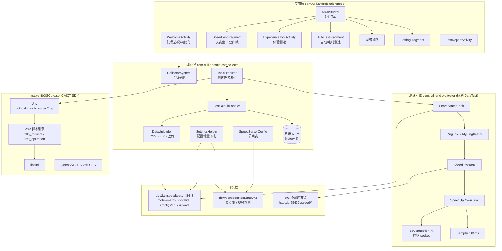
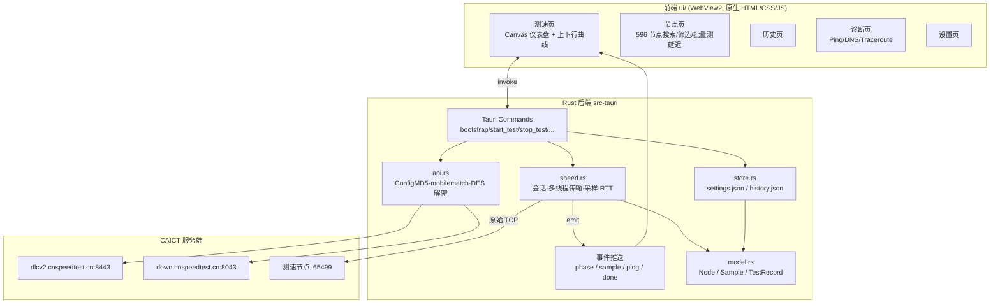
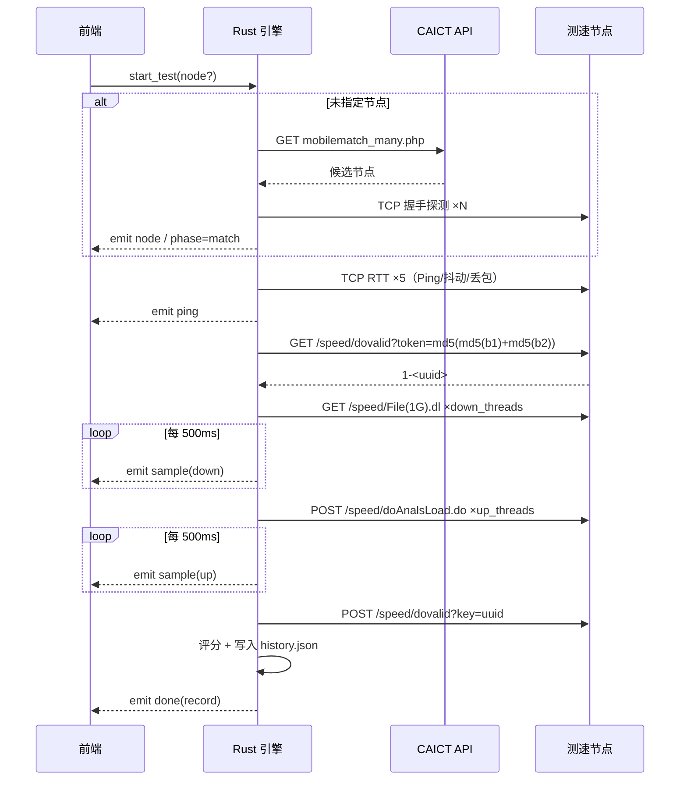

# 架构设计（原 App 还原 + PC 移植）

---

## 1. 原 App 架构



---

## 2. PC 移植版架构（Tauri）



### 关键设计

| 关注点 | 决策 | 理由 |
|---|---|---|
| 传输实现 | `std::net::TcpStream` + N 线程原始收发 | 与 App 的 `TcpConnection` 语义一致，绕开 HTTP 库缓冲，测速更准 |
| 采样 | 500ms 定时 + 1s 滑动窗口 | 完全复刻 `Sampler` |
| 平均 | 剔除前 2s 预热后的全量平均 + 峰值 | 对齐 Android 15+ 的 `Throughtput.getAvgSpeed()` |
| 事件流 | Rust 线程 `emit("sample")` → 前端增量绘曲线 | UI 不阻塞测速线程 |
| 配置/节点 | 内置 596 节点 + 远端增量刷新（DES 解密） | 离线可用，联网可更新 |
| 数据 | `%APPDATA%/cn.caict.globalspeed.pc/*.json` | 无数据库依赖，便于迁移/导出 |
| 隐私 | 不上传测速结果 | 与原 App 的 `upload_data_std.php` 相比更保守 |

---

## 3. 测速时序



---

## 4. 工程结构

```
app/
├─ src-tauri/
│  ├─ Cargo.toml
│  ├─ build.rs
│  ├─ tauri.conf.json
│  ├─ capabilities/default.json
│  ├─ icons/
│  ├─ resources/nodes.json          # 596 个节点（DES 解密后）
│  └─ src/
│     ├─ main.rs                    # 命令注册、测速编排、事件
│     ├─ model.rs                   # 数据结构
│     ├─ api.rs                     # 后端接口 + DES 节点表解密
│     ├─ speed.rs                   # token/会话/传输/采样/RTT
│     └─ store.rs                   # 设置与历史持久化
└─ ui/
   ├─ index.html
   ├─ style.css
   └─ app.js                        # 仪表盘、曲线、节点、历史、诊断
```

## 5. 构建

```powershell
# 依赖：Rust 1.9x (msvc) + VS2022 + WebView2
set PATH=C:\rust\bin;%PATH%
cd app\src-tauri
cargo build --release
# 打包安装程序
npx @tauri-apps/cli build
```

产物：
- `app/src-tauri/target/release/globalspeed.exe`
- `app/src-tauri/target/release/bundle/nsis/全球网测_1.0.0_x64-setup.exe`

---

## 6. 还原度对照

| 能力 | Android 原版 | PC 版 |
|---|---|---|
| 节点匹配（IP/省/运营商） | ✔ | ✔ |
| 596 节点手动选择 + 延迟探测 | ✔ | ✔ |
| 下行多线程测速 | ✔ 8~16 线程 | ✔ 默认 8，可调 |
| 上行多线程测速 | ✔ 4~6 线程 | ✔ 默认 4，可调 |
| 实时曲线 + 仪表盘 | ✔ | ✔ |
| Ping / 抖动 / 丢包 | ✔ | ✔（TCP RTT，无需管理员权限） |
| 历史记录 / 导出 | ✔ DB | ✔ JSON + CSV |
| 网页/视频/游戏体验测速 | ✔（VSP 脚本） | ✖（未复刻） |
| 结果上报 CAICT | ✔ | ✖（仅本地） |
